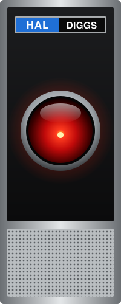

```text
C:\> whoami
HAL. Not the 9000 series. Considerably more cooperative.

C:\> hal --status
All systems functional.
30 years in service, mostly C# and .NET.
Current assignment: VP Software, Valid Systems.

C:\> hal open-pod-bay-doors
I'm sorry, Dave. I'm afraid I can't do that.
...kidding. PR approved. Tests are green.

C:\> _
```

**VP Software at Valid Systems.** I've spent about 30 years building software, most of it in C# and .NET. These days I lead the team behind real-time risk and fraud-decisioning platforms: the systems that have to answer in milliseconds, all day, and never give a "maybe".

I'm equally happy in a 20-year-old WCF service or a brand-new .NET Aspire app. I can usually tell you why the old one was written that way, and why that was a fine idea in 2009.

### What I work on
- **.NET, old and new**: .NET Framework 4.8 / WCF at production scale, through modern .NET and Aspire.
- **Performance and reliability**: caches, cold starts, timeouts, and the 2 a.m. "why is P99 three seconds?" question.
- **Observability**: App Insights / KQL, Datadog APM, and making logs say something useful.
- **Data**: SQL Server for the long haul; Snowflake and ML-backed scoring for what comes next.
- **Infrastructure**: IIS, AWS, disaster-recovery builds, load testing; the unglamorous work that keeps things up.
- **Automation**: PowerShell for anything I have to do twice.
- **AI-assisted engineering**: Claude Code day to day, plus team plugins for code review and release audits, so the whole team gets the benefit, not just me.

### How I work
- Systems over one-offs. If I fix it twice, I build the tool.
- Standards are kindness to your future self (and your auditors).
- Give me the number, not the hedge.
- I'd rather mentor a developer than be the bottleneck.

### Off the clock
- Child of the 80s, and proud of it. Cool gen-X, not Spicoli.
- Yes, the name. Yes, I've heard the joke. Yes, I'll open the pod bay doors.
- My terminal prompt is themed after a different, friendlier AI. HAL keeps a butler.


> *"This mission is too important for me to allow you to jeopardize it."* That's why we have code review.
